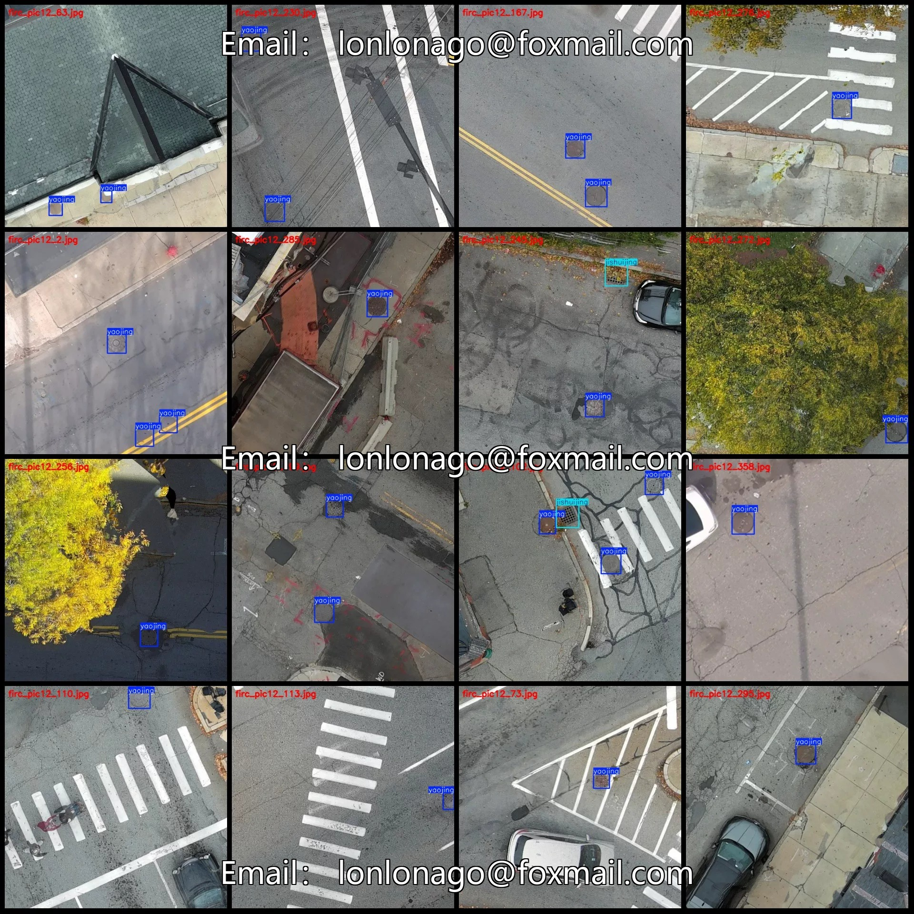
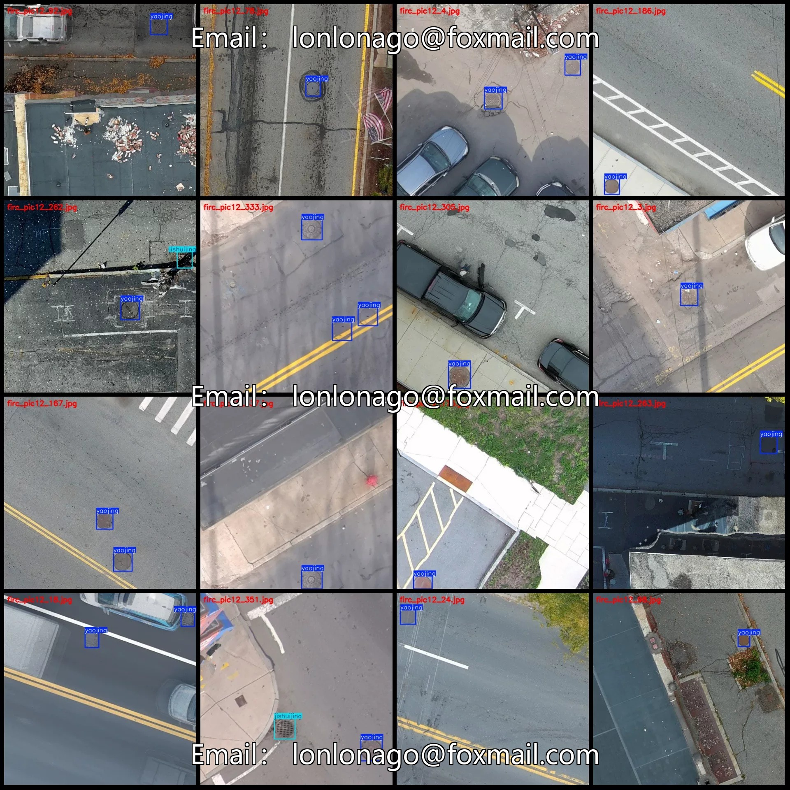
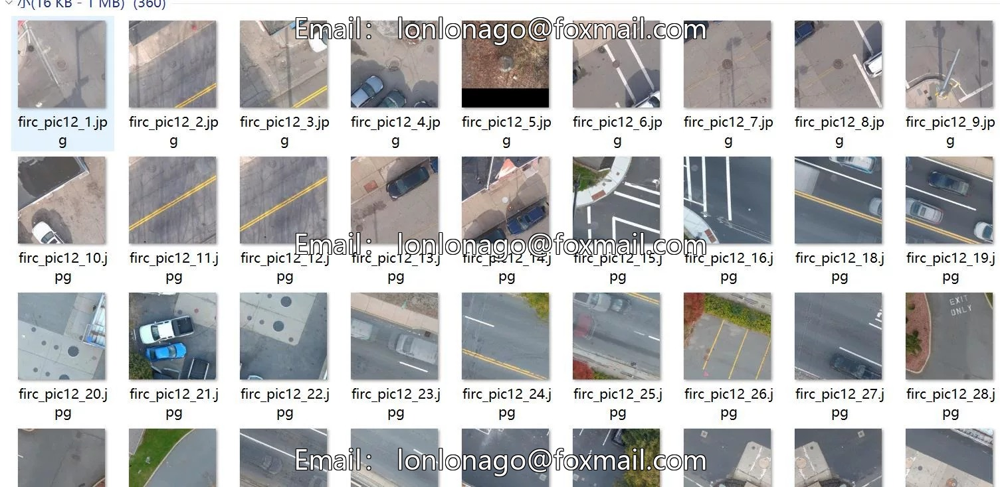
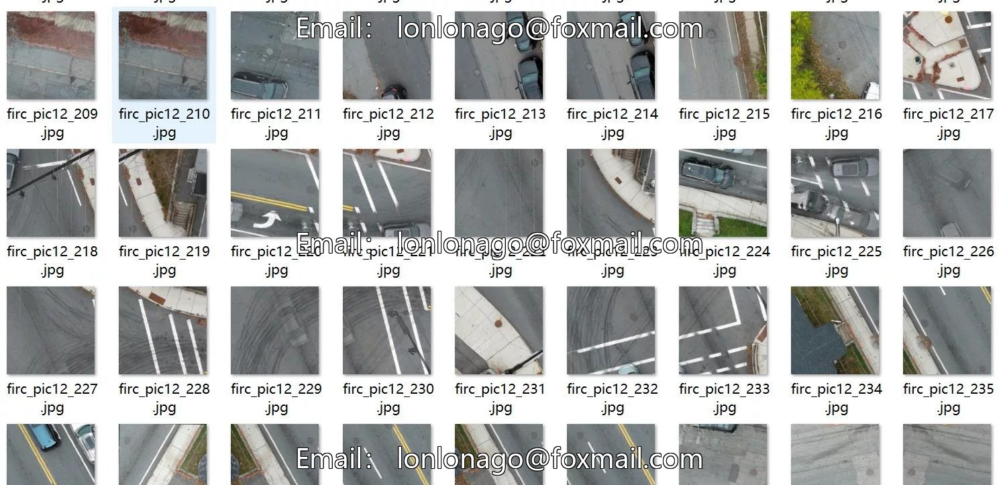
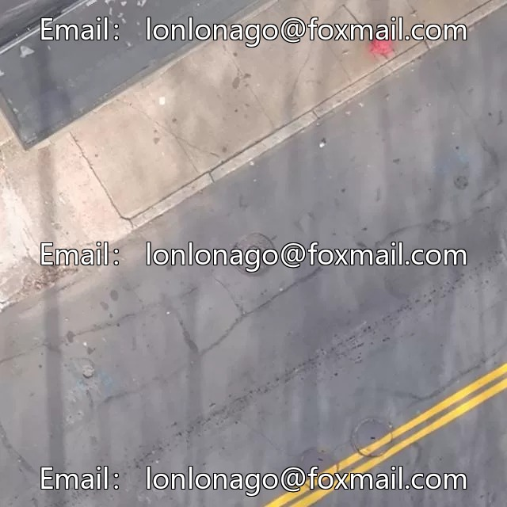
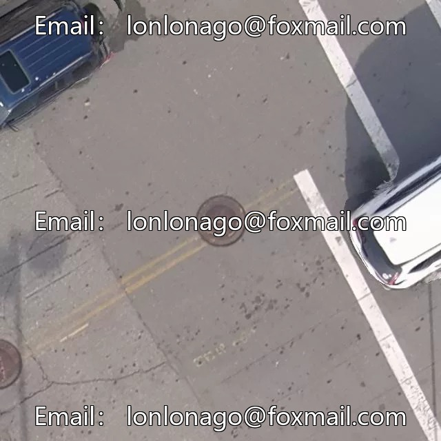
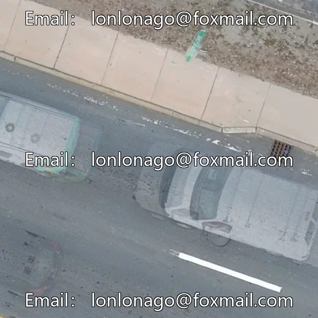

# Drone-view aerial photography dataset of road manholes, water wells, and culvert inspections with VOC+YOLO format

## Body

Drone-view aerial photography dataset for road and sewer inspection: 361 images in VOC+YOLO format, 2 categories
Warm Reminder: Due to the dataset's replicability, please confirm compliance with requirements before purchasing.
Dataset format: Pascal VOC format + YOLO format (txt files without split paths, only containing jpg images along with corresponding VOC format xml files and yolo format txt files)
Number of images (number of jpg files): 361
Number of annotations (number of xml files): 361
Number of annotations (number of txt files): 361
Number of annotation categories: 2

Label categories (Note that the order of labels in YOLO format does not correspond to this, but is based on the classes.txt file in the labels folder): ["jishuijing", "yaojing"]
Number of boxes and images per category:
- Jishuijing (collective well) = 45 boxes, 45 images
- Yaojing (tunnel) = 472 boxes, 361 images
Total number of boxes: 517
Image resolution: 640x640
Labeling tool used: labelImg
Labeling rules: Draw a rectangle around the category
Important note: The dataset does not have split into training, validation, or test sets; you will need to manually divide it.

Special : This dataset does not guarantee the accuracy of the trained models or weight files.

## Images

## Payment

Here is a pay link on Stripe ( https://buy.stripe.com/3cs8yP7sY87d0vu9AB ). Please contact me lonlonago@foxmail.com after funding $89, and I will send you a complete data files , thank you!

